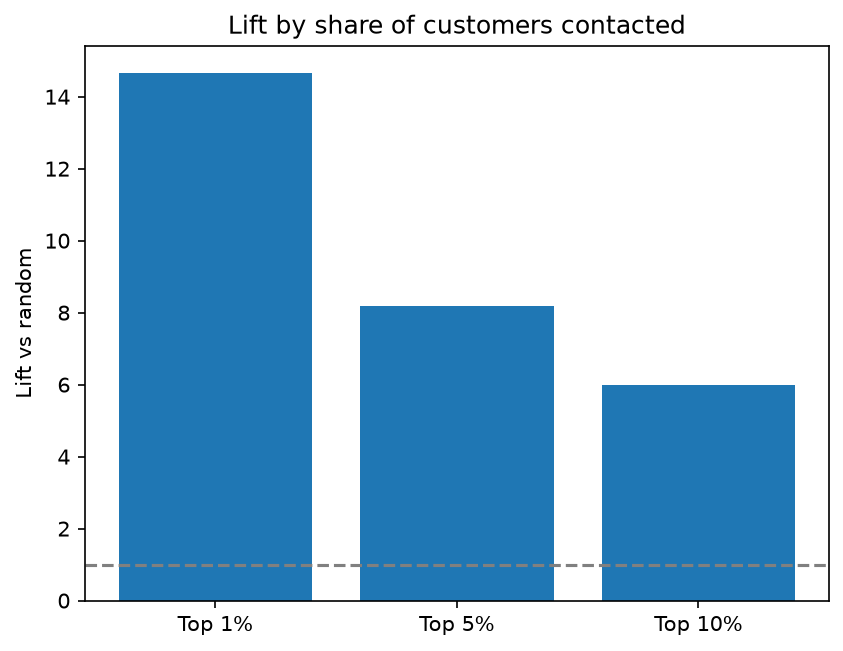
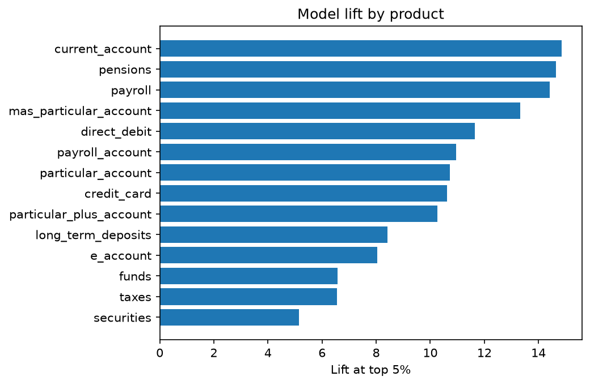
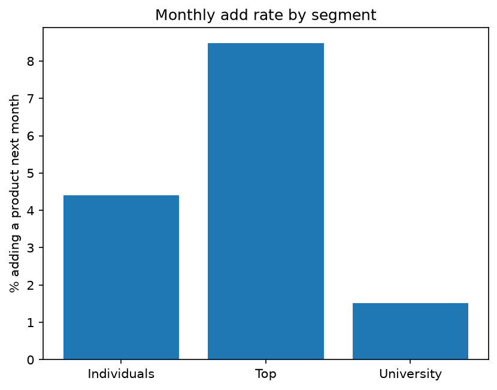

# Bank Cross-Sell Analytics: Predicting the Next Product a Customer Adds

A marketing analytics project on 13.6 million rows of real bank data. It answers one business question: **which customers should a bank target, and with which product, to maximize cross-sell conversion per customer contacted?**

## Headline result

Contacting the top 1% of customers ranked by the model reaches customers who add a product next month **14.7 times more often than a random list** (53% against 3.6%).



| Customers contacted (ranked by model) | Add rate next month | Lift vs random |
|---|---|---|
| Top 1% | 53.0% | 14.7x |
| Top 5% | 29.6% | 8.2x |
| Top 10% | 21.7% | 6.0x |
| Everyone (random) | 3.6% | 1.0x |

## Data

[Santander Product Recommendation](https://www.kaggle.com/c/santander-product-recommendation) (Kaggle, 2016). Monthly snapshots of what each customer of a Spanish bank held.

- 13,647,309 customer-months, about 956,000 customers, 17 months (January 2015 to May 2016)
- 24 product flags (current account, credit card, direct debit, pensions and so on)
- Customer age, tenure, income, segment and sex

The raw file is not in this repository (Kaggle competition rules). Download `train_ver2.csv` from the link above and place it in `data/raw/`.

## Approach

1. **Loading on a small laptop (8 GB):** converted the CSV to Parquet with DuckDB, then loaded only the needed columns with small data types (560 MB in memory).
2. **Cleaning:** removed impossible ages and a placeholder tenure value, filled missing income by segment median and capped extreme incomes, labeled missing categories Unknown.
3. **Defining the target:** a product is "added" when a customer holds it this month and did not last month. The model predicts whether a customer adds at least one product next month.
4. **Finding a data artifact:** about 193,000 customers appear for the first time in July 2015 with long tenure, and 90% of them hold no product. They are a batch added to the file, not new customers, so the zero-product customers in that batch were excluded from training and testing.
5. **Time-based split:** trained on months up to February 2016, tested on the latest two months. A random split would leak the future into training.
6. **Model:** gradient boosting (scikit-learn `HistGradientBoostingClassifier`) trained on a 1 million row sample.
7. **Evaluation:** lift at the top 1%, 5% and 10% of customers by score. Accuracy is not used because 96% of customers add nothing, so a useless model would score 96%.

### How the model improved

| Features | Top 1% lift | Top 5% lift | Top 10% lift |
|---|---|---|---|
| Age, tenure, income, number of products | 8.6x | 4.4x | 3.5x |
| plus 15 product flags | 13.6x | 7.3x | 5.1x |
| plus segment and sex | 13.5x | 7.3x | 5.1x |
| plus recent additions (last 1 and 3 months) | 14.7x | 8.2x | 6.0x |

Recent behavior and current holdings mattered most. Segment and sex added almost nothing once holdings were known.

## Findings

### Lift by product



Every product with enough data is predicted 5x to 15x better than random. Current account, pensions and payroll are the easiest to predict. Short-term deposits had no additions in the test months, so no lift could be computed.

### Who adds products



| Group | Finding |
|---|---|
| Top segment | Highest add rate (8.5%), with credit card (2.2% against 0.55% overall) and e-account (2.0% against 0.33%) standing out |
| Individuals | Largest group (820,000), with steady direct debit (1.7%), pensions and payroll |
| University | Lowest rate for every product (1.5% overall), so poor cross-sell targets |
| Ages 35 to 50 | Highest add rate (5.5%) among large age groups |
| Under 25 | Very low add rates |

### Products added together

Pensions and direct debit are added in the same month about **20 times more often than chance** (4,652 months). Funds and long-term deposits show a smaller link (4.2x, 437 months). Most other pairs are added in different months.

## Business recommendations

1. **Rank customers with the model and contact only the top slice.** The top 5% adds products at 8x the random rate.
2. **Target Top-segment customers with credit cards and e-accounts.** Their add rates are 4x to 6x the overall rates for those products.
3. **Offer pensions and direct debit as a pair.** They are strongly linked.
4. **Use direct debit, pensions and payroll as the volume play for Individuals.**
5. **Do not spend cross-sell budget on University customers.** Their add rates are the lowest for every product.
6. **Treat customers with an Unknown segment as an onboarding group.** Their very high current-account rate points to new customers opening their first account, which is a different campaign.

## Limitations

- **No campaign data.** The dataset does not say who was contacted, so results describe natural product-adding behavior. Lift shows who is most likely to add a product, not the effect of a marketing message. A real campaign should be tested against a holdout group.
- **Short test window.** The test covers two months, and the add rate fell over time (4.1% in training against 3.6% in testing).
- **Rare products are noisy.** Products with a few hundred test additions (funds, securities, the particular accounts) have unreliable lifts.
- **Nine products were left out.** Savings account, guarantees, home account, mortgage, derivatives account, loans, medium-term deposits, junior account and pension plan have fewer than 1,000 additions in 17 months. Mortgages and loans matter to a bank, but there is too little data to model them.
- **Product names** follow the competition's data description and should be checked against the Kaggle data page.
- **Ages under 18** were kept. They are real children with junior accounts.
- **Training used a 1 million row sample** because of the 8 GB memory limit. A full-data fit or tuning could improve results slightly.

## Repository structure

```
santander-cross-sell/
  data/raw/          raw Kaggle file (not included)
  data/processed/    Parquet files created by the notebook (not included)
  notebooks/         the analysis notebook
  charts/            charts used in this README
  README.md
  requirements.txt
  .gitignore
```

## How to run

### Prerequisites

- Python 3.10 or newer and pip
- A free Kaggle account (needed to download the data)
- About 8 GB of memory and 10 GB of free disk space (the raw file is about 2 GB, and the Parquet files add more)
- Git
- A terminal (Terminal on Mac, PowerShell or Git Bash on Windows)

### 1. Clone the repository

```
git clone https://github.com/<your-username>/santander-cross-sell.git
cd santander-cross-sell
```

### 2. Create an environment and install dependencies

```
python3 -m venv venv
source venv/bin/activate
pip install -r requirements.txt
```

On Windows, activate with `venv\Scripts\activate` instead of `source venv/bin/activate`.

### 3. Get the data (configuration)

The project needs no API keys or environment variables. The only setup is downloading the data, which cannot be included in the repository.

1. Sign in to Kaggle and open the [competition page](https://www.kaggle.com/c/santander-product-recommendation).
2. Accept the competition rules on the Data tab. The download button stays hidden until you do.
3. Download `train_ver2.csv.zip` and put it in `data/raw/` (create the folders if they do not exist).
4. Unzip it:

```
mkdir -p data/raw data/processed charts
unzip data/raw/train_ver2.csv.zip -d data/raw
```

You should now have `data/raw/train_ver2.csv` (about 2 GB). The notebook uses relative paths such as `../data/raw/train_ver2.csv`, so keep this folder layout.

Optional: with the Kaggle command line tool and an API token saved at `~/.kaggle/kaggle.json`, step 3 can be done with `kaggle competitions download -c santander-product-recommendation -f train_ver2.csv.zip -p data/raw`. You still have to accept the rules on the website first.

### 4. Run the notebook

```
cd notebooks
jupyter lab
```

JupyterLab opens in your browser. Open `santander_cross_sell_analysis.ipynb` and run it from top to bottom: in the menu choose Kernel, then Restart Kernel and Run All Cells.

The notebook is organized in sections, in this order:

| Section | What it does | Output |
|---|---|---|
| Load | Converts the CSV to Parquet with DuckDB, then loads the needed columns with small types | `data/processed/train.parquet` |
| Clean | Renames columns, sorts by customer and date, fixes age, tenure and income, fills missing values | `data/processed/clean.parquet` |
| Additions and exploration | Finds product additions, applies the product cutoff, explores the data, flags the July 2015 batch | `data/processed/added.parquet` |
| Model and results | Builds the time split, features and model, then lift, product, segment and affinity results | PNG files in `charts/` |

Some cleaning cells (for example adding the Unknown category) fail if they are run twice in the same session. If that happens, restart the kernel and run the notebook again from the top.

### 5. Expected output

- The Parquet conversion shows a progress bar and takes a few minutes. Afterwards `data/processed/` holds the Parquet files.
- The cleaning section prints the shape `(13647309, 31)` and no missing values, then saves `clean.parquet`.
- The additions section keeps 15 products (about 561,500 additions) and flags 13.85% of rows as excluded.
- The model section prints 9,457,325 training rows and 1,508,451 test rows. It then fits four models, which takes several minutes, and prints the lift for each feature set. The last one is close to:

```
0.01 0.5298 14.67
0.05 0.2959 8.19
0.1 0.2165 5.99
```

Each entry shows the share of customers contacted, the add rate in that group and the lift. Small differences from the numbers above are normal, because the training sample is random. The three charts are saved into `charts/`.

## Tools

Python, pandas, DuckDB, Parquet, scikit-learn, matplotlib, JupyterLab.
